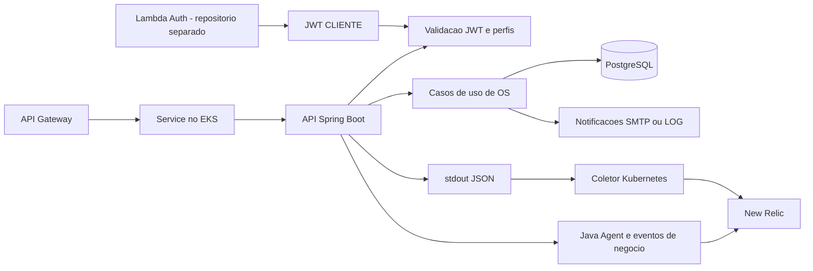

# oficina-dgcar-api

API Spring Boot da Oficina DGCar. Implementa clientes, veículos, ordens de serviço, diagnóstico, orçamento, execução, pagamento, entrega e notificações. Mantém as migrations Flyway e o contrato OpenAPI. Os ambientes AWS são `homolog` e `prod`.

A autenticação de funcionários usa JWT interno e perfis ATENDENTE, MECANICO e GESTOR. O JWT CLIENTE é emitido pela Lambda Auth; a API valida assinatura, issuer, audience e tipo, restringindo a consulta externa às OS do cliente autenticado.

## Tecnologias

Java 17, Spring Boot, Spring Security, Maven, JPA/Hibernate, PostgreSQL 16, Flyway, JUnit, Testcontainers, JaCoCo, Docker Compose, Kubernetes, OpenAPI/Swagger, Micrometer e New Relic Java Agent. GitHub Actions realiza validação e deploy no EKS, com imagens no ECR.

## Arquitetura deste repositório



EKS, Gateway e coletor são provisionados por [infra-k8s](https://github.com/techdgconsulting/oficina-dgcar-infra-k8s). O RDS é responsabilidade de [infra-db](https://github.com/techdgconsulting/oficina-dgcar-infra-db); a autenticação externa fica em [auth-lambda](https://github.com/techdgconsulting/oficina-dgcar-auth-lambda).

## Execução local

Escolha uma das opções abaixo. Ambas expõem a API na porta **8080**. Os comandos são executados na raiz deste repositório.

### Aplicação e PostgreSQL pelo Docker Compose

Pré-requisitos: Docker com Compose, acesso aos registries e porta 8080 disponível. O build também baixa dependências e o Java Agent.

```sh
docker compose up -d --build
docker compose ps
docker compose logs --tail=100 app
```

O Compose sobe **app e db**, aguarda o healthcheck do banco e executa a API. Não é necessário iniciar Maven em paralelo.

| Conexão | Endereço |
|---|---|
| API no host | `http://localhost:8080` |
| PostgreSQL a partir do host | `localhost:5434` |
| PostgreSQL a partir do container app | `db:5432` |
| Banco | `oficina` |

O Compose usa volume `pgdata`. `docker compose down` encerra os serviços mantendo esse volume. As migrations são aplicadas pela API ao iniciar.

Um arquivo `.env` local pode fornecer `POSTGRES_USER`, `POSTGRES_PASSWORD` e `JWT_SECRET`, sem versionar segredos. Mantenha `POSTGRES_DB=oficina`: a URL JDBC do serviço app está fixada nesse nome no Compose. Alterar somente `POSTGRES_DB` não atualiza essa URL. As credenciais devem corresponder às já usadas para inicializar o volume.

### Aplicação pelo Maven e somente PostgreSQL pelo Compose

Pré-requisitos: JDK 17, Maven e Docker. Se a aplicação do Compose estiver ativa, encerre apenas esse serviço:

```sh
docker compose stop app
docker compose up -d db
```

Configure o processo Maven para acessar a porta publicada do banco. Exemplo em PowerShell, depois de definir `POSTGRES_USER`, `POSTGRES_PASSWORD` e `JWT_SECRET` no ambiente do terminal:

```powershell
$env:SPRING_DATASOURCE_URL = 'jdbc:postgresql://localhost:5434/oficina'
$env:SPRING_DATASOURCE_USERNAME = $env:POSTGRES_USER
$env:SPRING_DATASOURCE_PASSWORD = $env:POSTGRES_PASSWORD
$env:OFICINA_EMAIL_ENABLED = 'false'
$env:OFICINA_EMAIL_MODE = 'LOG'
$env:PAGAMENTO_GATEWAY_APPROVAL_RATE = '1.0'
$env:PAGAMENTO_GATEWAY_LATENCY_MS = '0'
mvn spring-boot:run
```

O Maven não carrega automaticamente o `.env` do Compose. Sem sobrescrita, `application.yml` aponta para PostgreSQL em `localhost:5432`; por isso a URL acima é necessária para usar o banco publicado em 5434. Use as mesmas credenciais configuradas no serviço db.

O perfil `dev` usa H2 em memória, desabilita Flyway e recria o schema; não equivale ao ambiente PostgreSQL com migrations e massa persistida.

### Configuração funcional

| Configuração | Finalidade |
|---|---|
| `SPRING_DATASOURCE_URL`, `SPRING_DATASOURCE_USERNAME`, `SPRING_DATASOURCE_PASSWORD` | Conexão PostgreSQL |
| `JWT_SECRET` | Assinatura do JWT interno; configure uma chave adequada para HS256 |
| `CLIENT_JWT_SECRET`, `CLIENT_JWT_ISSUER`, `CLIENT_JWT_AUDIENCE` | Validação do JWT externo; o segredo deve corresponder ao da Lambda no mesmo ambiente |
| `OFICINA_PUBLIC_BASE_URL` | Base dos links de notificação; localmente pode ser `http://localhost:8080` |
| `OFICINA_EMAIL_ENABLED`, `OFICINA_EMAIL_MODE` | Habilitação de notificações e escolha de LOG ou SMTP |
| `SMTP_HOST`, `SMTP_PORT`, `SMTP_USERNAME`, `SMTP_PASSWORD` | Necessários conforme o servidor SMTP utilizado |
| `PAGAMENTO_GATEWAY_APPROVAL_RATE`, `PAGAMENTO_GATEWAY_LATENCY_MS` | Aprovação e latência do gateway simulado |
| `OFICINA_DASHBOARD_MASSA_HISTORICA_ENABLED` | Habilita o recurso de massa histórica quando necessário ao roteiro de validação |

No Compose atual, `CLIENT_JWT_*` e `OFICINA_PUBLIC_BASE_URL` não são repassados ao serviço app. Defini-los apenas no `.env` não os injeta no container; o teste integrado com a Lambda exige configurá-los no ambiente efetivo da API. A Lambda também não é iniciada pelo Compose.

## Validação e contratos

```sh
mvn clean test
```

Docker deve estar disponível para os testes PostgreSQL com Testcontainers. Confira `target/surefire-reports` e `target/site/jacoco`; testes unitários não substituem a validação integrada pelo Gateway.

- [Swagger UI local](http://localhost:8080/swagger-ui.html).
- [OpenAPI JSON local](http://localhost:8080/api-docs).
- [Readiness local](http://localhost:8080/actuator/health/readiness).
- [Collection Postman](postman/Oficina-DGCar-Tech-Challenge-Fase-3.postman_collection.json).
- [Roteiro do dashboard de negócio](postman/VALIDACAO-DASHBOARD-NEGOCIO.md).

Em homolog e prod, substitua a base local pelo `OFICINA_PUBLIC_BASE_URL` do ambiente: Swagger em `/swagger-ui.html`, OpenAPI em `/api-docs` e readiness em `/actuator/health/readiness`. O provisionamento publica a base do Gateway; o ID não é fixado neste README.

O login interno é `POST /api/auth/login`. O contrato externo é `POST /auth/cpf` pelo Gateway, implementado pela Lambda. JWT CLIENTE permite consultar as próprias OS por `/api/ordens-servico/numero/{numero}` e `/api/ordens-servico/numero/{numero}/status`, conforme as regras de autorização.

### Collection funcional e carga concorrente

Importe a collection e configure `baseUrl` e as variáveis de autenticação para o ambiente. Execute as pastas funcionais na ordem, verificando as asserções. A rota `/auth/cpf` exige Gateway e Lambda; não funciona somente com a API local.

O Runner funcional sequencial valida contratos e gera massa, mas não comprova carga concorrente ou escala do HPA. O ensaio automatizado versionado usa k6 no repositório de infraestrutura; consulte [VALIDACAO-HPA.md](https://github.com/techdgconsulting/oficina-dgcar-infra-k8s/blob/homolog/README.md#hpa-e-capacidade).

O [roteiro de HPA e falhas de processamento no Postman](postman/VALIDACAO-POSTMAN-OBSERVABILIDADE.md) acompanha a collection. Reimporte o arquivo atualizado antes de usar essas pastas.

## Análise de vulnerabilidades com Trivy

### Versões adotadas nas correções

O [pom.xml](pom.xml) define Spring Boot **4.0.8**, Jackson BOM **3.1.7**, Jackson 2 BOM **2.22.3**, Tomcat **11.0.27** e SpringDoc OpenAPI **3.0.3**. Commons Lang **3.18.0** e driver PostgreSQL **42.7.12** permanecem explicitados no gerenciamento de dependências. O parent gerencia as demais versões.

A migração ajusta os starters Web MVC, Flyway e testes, além dos artefatos Testcontainers. As escolhas e o escopo das evidências estão nas [ADRs de stack e segurança](https://github.com/techdgconsulting/oficina-dgcar-docs/tree/homolog/docs/adr), especialmente ADR-008, ADR-009 e ADR-012.

### Relatórios disponíveis

Os relatórios de 17/10/2026 estão em `docs/ReportTRIVY`:

| Análise | Relatório HTML | Dados JSON | HIGH | CRITICAL |
|---|---|---|---|---|
| Dependências Maven do `pom.xml` | [Dependências](docs/ReportTRIVY/trivy-dependencies-report.html) | [JSON das dependências](docs/ReportTRIVY/trivy-dependencies-report.json) | 0 | 0 |
| Imagem Docker `oficina-dgcar-api:security-validation` | [Imagem Docker](docs/ReportTRIVY/trivy-image-report.html) | [JSON da imagem](docs/ReportTRIVY/trivy-image-report.json) | 0 | 0 |

A análise usa Trivy 0.73.0 e o filtro `HIGH,CRITICAL`. O relatório da imagem cobre pacotes do sistema operacional e bibliotecas Java embarcadas; o relatório Maven cobre as dependências resolvidas pelo scanner a partir do POM. Esses comandos não analisam segredos nem configurações de infraestrutura. O resultado corresponde à imagem local e à base de vulnerabilidades usada na execução; não comprova a versão implantada em homolog ou prod.

### Gerar os relatórios JSON

Execute na raiz deste repositório, em PowerShell, com Docker Desktop iniciado. A análise do POM utiliza o cache Maven em `$env:USERPROFILE\.m2\repository`; execute `mvn verify` antes para resolver as dependências e validar a aplicação. O volume `dgcar-trivy-cache` reaproveita as bases do scanner entre execuções.

```powershell
$trivy = 'aquasec/trivy:0.73.0'
$reports = (New-Item -ItemType Directory -Force -Path 'docs/ReportTRIVY').FullName

docker build -t oficina-dgcar-api:security-validation .
if ($LASTEXITCODE -ne 0) { throw 'Falha no build da imagem.' }

docker run --rm `
  --mount 'type=bind,source=/var/run/docker.sock,target=/var/run/docker.sock' `
  --mount 'type=volume,source=dgcar-trivy-cache,target=/root/.cache/trivy' `
  --mount "type=bind,source=$reports,target=/reports" `
  $trivy image `
  --scanners vuln --timeout 5m --severity HIGH,CRITICAL `
  --format json --output /reports/trivy-image-report.json `
  oficina-dgcar-api:security-validation
if ($LASTEXITCODE -ne 0) { throw 'Falha na análise da imagem.' }

docker run --rm `
  --mount "type=bind,source=$($PWD.Path)\pom.xml,target=/project/pom.xml,readonly" `
  --mount "type=bind,source=$env:USERPROFILE\.m2\repository,target=/root/.m2/repository,readonly" `
  --mount 'type=volume,source=dgcar-trivy-cache,target=/root/.cache/trivy' `
  --mount "type=bind,source=$reports,target=/reports" `
  $trivy fs `
  --scanners vuln --timeout 3m --severity HIGH,CRITICAL `
  --format json --output /reports/trivy-dependencies-report.json `
  /project
if ($LASTEXITCODE -ne 0) { throw 'Falha na análise das dependências.' }
```

O primeiro download das bases pode demorar. Uma execução encerrada com `FATAL` ou timeout não produz um relatório válido. Os comandos mantêm o código de saída padrão do Trivy: encontrar vulnerabilidades não reprova automaticamente a execução; confira os achados no relatório.

### Converter os JSONs para HTML

A conversão usa os JSONs já gerados e não repete a análise:

```powershell
$trivy = 'aquasec/trivy:0.73.0'
$reports = (Resolve-Path 'docs/ReportTRIVY').Path

foreach ($name in @('trivy-image-report', 'trivy-dependencies-report')) {
    docker run --rm `
      --mount "type=bind,source=$reports,target=/reports" `
      $trivy convert `
      --format template --template '@/contrib/html.tpl' `
      --output "/reports/$name.html" "/reports/$name.json"
    if ($LASTEXITCODE -ne 0) { throw "Falha ao converter $name." }
}
```

Abra os arquivos `.html` no navegador. No GitHub, o link exibe o arquivo; para visualizar a página formatada, faça o download e abra localmente. O Trivy é executado manualmente neste procedimento; não há etapa Trivy configurada nos workflows atuais da API.

## Relatório OWASP ZAP

O [relatório de 19/10/2026](docs/ReportOWASP/2026-10-19-ZAP-Report-.html) registra a análise local da API. Os arquivos de estilo e imagens que acompanham o HTML ficam no mesmo diretório. Para visualizar o relatório formatado, baixe o HTML junto da pasta de recursos e abra no navegador.

O resultado corresponde ao alvo, à autenticação e às regras utilizados nessa execução; não comprova o estado de homolog ou prod.

## CI/CD e deploy

O workflow [app-cd.yml](.github/workflows/app-cd.yml) tem estes gatilhos:

| Evento | Execução |
|---|---|
| PR para `homolog` ou `main` | `mvn clean test` e build da imagem, sem deploy |
| Merge em `homolog` ou `main` | Testes e solicitação automática de deploy à fila central; filtro em código, build, workflow e `scripts/ci/**` |
| `workflow_dispatch` | Reexecução manual encaminhada à mesma fila; `homolog` usa a branch `homolog` e `prod` usa `main` |

Push em `homolog` seleciona homolog; push em `main` seleciona prod. Alterações apenas em README ou Postman não atendem ao filtro de push desse workflow. O workflow [ci.yml](.github/workflows/ci.yml) separado verifica a estrutura do repositório em PRs e pushes dessas branches.

Para reexecutar o deploy: **Actions → App CI/CD - Build, Test and Deploy → Run workflow**, selecione a referência de código e `environment`. O pedido entra no coordenador de infra-k8s, que despacha o worker com o SHA de origem e o identificador da execução pai. Esses campos são reservados à automação. O ambiente deve possuir EKS, ECR e banco acessíveis.

O deploy publica a imagem no ECR, conecta ao EKS, aplica namespace, ConfigMap, Secret, Deployment, Service e HPA, reinicia o Deployment e aguarda o rollout. Ao final, publica `API_BACKEND_URL` no environment correspondente de infra-k8s.

Configure por environment: credenciais AWS, `AWS_REGION`, `ECR_REPOSITORY`, `EKS_CLUSTER_NAME`, conexão `SPRING_DATASOURCE_*`, `JWT_SECRET`, `CLIENT_JWT_SECRET`, `GH_AUTOMATION_TOKEN` e `NEW_RELIC_LICENSE_KEY`. Configure SMTP conforme o modo utilizado. O workflow aceita secrets ou variables para os destinos indicados no código, com precedência dos secrets; segredos de autenticação permanecem em secrets. `OFICINA_PUBLIC_BASE_URL` é obrigatório em nuvem e não pode apontar para localhost. Regras de aprovação dependem da configuração dos GitHub Environments.

## Observabilidade

O Java Agent fornece APM e os eventos customizados de OS. Os logs JSON saem no stdout e chegam ao New Relic pelo coletor Kubernetes; o workflow desabilita forwarding e decoração textual do agente. `correlationId` é atributo do log e da transação, com `trace.id` e `span.id` quando disponíveis.

`NEW_RELIC_APP_NAME` usa o padrão `oficina-dgcar-api-<ambiente>` e `NEW_RELIC_ENVIRONMENT` identifica o ambiente. `JAVA_TOOL_OPTIONS` carrega `/app/newrelic/newrelic.jar` no deploy. No Compose, o agente não é ativado por padrão e não há coletor Kubernetes; logs locais não comprovam ingestão no New Relic.

Os roteiros completos estão na [documentação central](https://github.com/techdgconsulting/oficina-dgcar-docs), em `docs/observabilidade/`, e na infraestrutura em [DASHBOARD-OPERACIONAL.md](https://github.com/techdgconsulting/oficina-dgcar-infra-k8s/blob/homolog/README.md#atualização-de-dashboards-e-observabilidade). Consulte a revisão correspondente à implantação; as alterações documentais locais seguem o estado do checkout até serem publicadas.

A origem da extração permanece em [ORIGEM_HISTORICA.md](ORIGEM_HISTORICA.md).

A fila por ambiente serializa API, Lambda, banco e plataforma com provisionamento e remoção. O deploy verifica o coordenador antes de acessar a AWS e usa o mesmo SHA nos testes e na imagem. PRs para `main` precisam conter o histórico de `homolog`. A decisão está na [ADR-020](https://github.com/techdgconsulting/oficina-dgcar-docs/blob/homolog/docs/adr/ADR-020-promocao-e-deploy-automatico.md).
